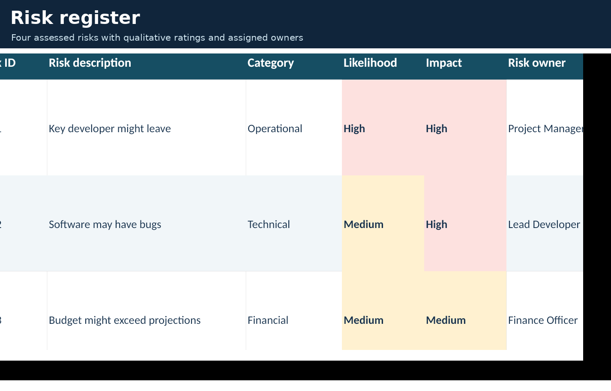
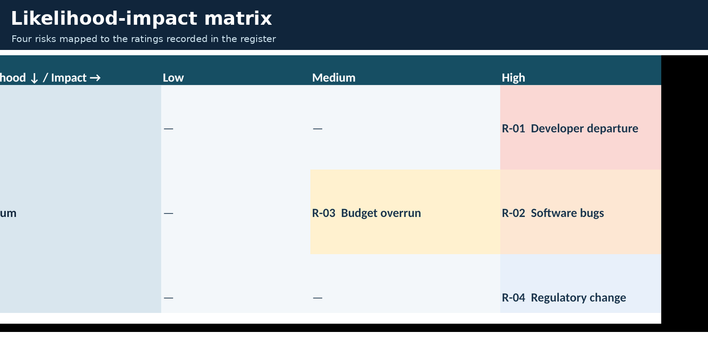

# Risk Assessment & Management — Software Development Project

I assessed **four risks** in a hypothetical software development project, recorded their likelihood and impact, assigned risk owners, and developed mitigation and contingency responses. I also organized the results into a risk register and a likelihood–impact matrix to make the assessment easier to review.

**Project type:** Risk management and planning case study  
**Assessment date:** September 2024  
**Tools and deliverables:** Excel risk register, qualitative 3×3 risk matrix, Word risk management plan

> **Scope:** This project evaluates software delivery, staffing, financial, and regulatory risks. It demonstrates a risk-assessment workflow relevant to governance and risk management; it is **not** a penetration test, security vulnerability assessment, or live organizational risk audit.

## Assessment results

| Risk | Category | Likelihood | Impact | Assigned owner |
|---|---|---|---|---|
| Key developer departure | Operational | **High** | **High** | Project Manager |
| Software defects | Technical | Medium | **High** | Lead Developer |
| Budget overrun | Financial | Medium | Medium | Finance Officer |
| Regulatory change affecting scope | External | Low | **High** | Compliance Officer |

**Outcome:** Four risks documented and categorized, four owner roles assigned, and mitigation plus contingency actions proposed for each. A **monthly review cadence** was specified in the management plan.

The editable register includes each risk's description, rating, owner, status, notes, proposed mitigation, and contingency response: **[Risk register and matrix workbook](risk_register_and_matrix.xlsx)**.

## Risk prioritization

The risk register identifies **key developer departure** as the only high-likelihood/high-impact risk. **Software defects** have medium likelihood and high impact; **budget overrun** has medium likelihood and medium impact; and **regulatory change** has low likelihood and high impact.

The matrix uses the same qualitative ratings recorded in the risk register. No numerical probability estimates or financial loss estimates were calculated.

## Proposed risk responses

| Risk | Proposed mitigation | Contingency / acceptance response |
|---|---|---|
| **Developer departure** | Cross-train team members and maintain detailed documentation. | Prepare temporary-staffing contingency arrangements. |
| **Software defects** | Introduce a rigorous testing phase and code reviews. | Reserve additional schedule time for bug fixes. |
| **Budget overrun** | Conduct regular budget reviews and maintain a contingency fund. | Adjust project scope if required to stay within budget. |
| **Regulatory change** | Monitor applicable regulations and consult a compliance specialist. | Adapt project deliverables to meet changed requirements. |

These are **proposed responses**, not controls demonstrated as implemented. The register marks the risks as *Active*, but the project does not document actual treatment completion or measured reduction in residual risk.

## Method and monitoring

1. **Identified** operational, technical, financial, and external risks that could affect project delivery.
2. **Assessed** each risk using qualitative likelihood and impact ratings (Low, Medium, High).
3. **Assigned** an accountable role for each risk in the register.
4. **Planned** mitigation and contingency actions tailored to each risk.
5. **Defined** monthly reviews to reassess risks and update the plan as project conditions change.

The plan assigns oversight of overall risk management to the Project Manager, technical issues to the Lead Developer, financial exposure to the Finance Officer, and regulatory changes to the Compliance Officer.

## Project deliverables

- **[Risk assessment case study](Risk-Assessment-Case-Study.md)** — detailed decisions, treatment plan, and limitations, with evidence visuals.
- **[Risk assessment report (PDF)](01-risk-assessment-case-study.pdf)** — standalone report of the assessment.
- **[Risk register and qualitative matrix (Excel)](risk_register_and_matrix.xlsx)** — editable record of ratings, owners, and proposed actions.

## Assessment limitations

This is a **hypothetical project**. The work demonstrates structured risk identification, qualitative assessment, ownership, and response planning. It does not establish that mitigations were executed, that monthly reviews occurred, or that project risks were reduced. The initial matrix draft used different risk descriptions and placements; the revised matrix is aligned with the recorded risk register.

---

**Author:** Silent Mucharira  
**Focus:** Risk assessment · Risk registers · Likelihood–impact analysis · Mitigation planning · Governance and risk management
