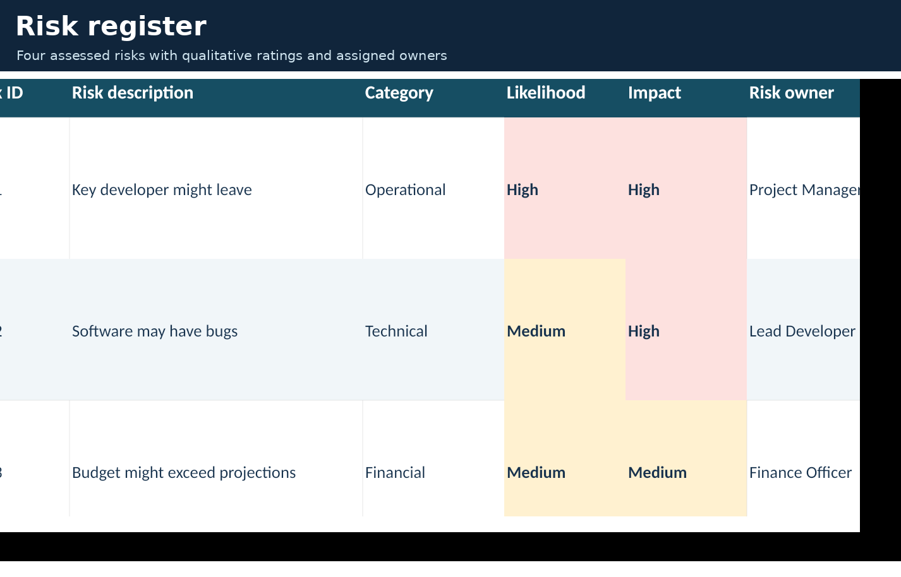
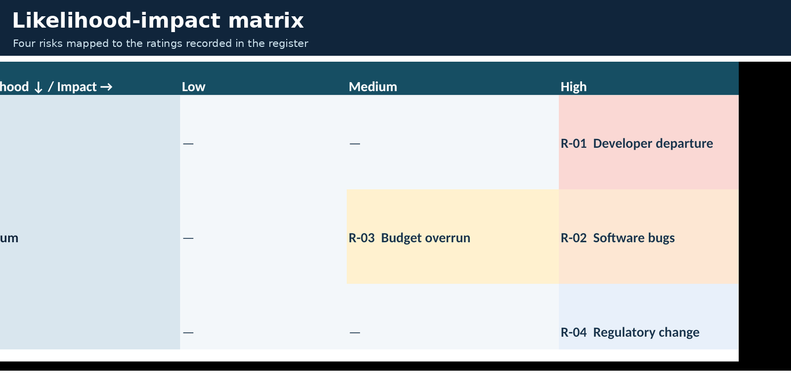

# Risk Assessment & Management — Technical Case Study

**Project:** Hypothetical software development project  
**Assessment date:** 8 September 2024  
**Prepared by:** Silent Mucharira  
**Approach:** Qualitative likelihood–impact assessment, risk ownership, mitigation and contingency planning

## 1. Project objective and scope

The project objective was to identify potential threats to successful software delivery, record their assessed likelihood and impact, and develop responses to support decisions about staffing, quality, budget, and regulatory compliance. This is a planning exercise rather than a completed organizational risk treatment program.

## 2. Work completed

- Created a four-entry risk register with risk category, description, qualitative likelihood, qualitative impact, assigned owner, status, and notes.
- Mapped the four registered risks to a 3×3 likelihood–impact matrix.
- Documented mitigation and contingency responses for each risk.
- Proposed monthly risk reviews and assigned responsibility across four project roles.

## 3. Risk register findings

| ID | Risk | Category | Likelihood | Impact | Owner |
|---|---|---|---|---|---|
| R-01 | Key developer might leave | Operational | High | High | Project Manager |
| R-02 | Software may have bugs | Technical | Medium | High | Lead Developer |
| R-03 | Budget might exceed projections | Financial | Medium | Medium | Finance Officer |
| R-04 | New regulations affecting scope | External | Low | High | Compliance Officer |

**Interpretation:** R-01 has the highest combined qualitative likelihood and impact. R-02 is a significant technical risk because of its high assessed impact. R-03 and R-04 represent different exposure profiles: medium/medium and low/high, respectively. The exercise did not use a numeric scoring or risk-appetite model.

## 4. Risk matrix

The matrix above reproduces the four risk ratings from the register. The initial draft matrix did not consistently match those records; the revised matrix resolves the presentation discrepancy without changing the registered ratings.

## 5. Proposed treatments and contingency responses

### R-01 — Key developer departure

**Assessment:** High likelihood / High impact.  
**Owner:** Project Manager.  
**Proposed mitigation:** Cross-train team members and maintain detailed project documentation.  
**Contingency:** Prepare a temporary-staffing plan if the key developer leaves.  
**Intended benefit:** Reduce single-person dependency and protect delivery continuity. **No implementation or measured benefit was documented.**

### R-02 — Software defects

**Assessment:** Medium likelihood / High impact.  
**Owner:** Lead Developer.  
**Proposed mitigation:** Apply rigorous testing and code reviews.  
**Contingency:** Reserve additional schedule time for defect remediation.  
**Intended benefit:** Detect defects earlier and reduce the chance of schedule disruption. **No test results or defect metrics were recorded.**

### R-03 — Budget overrun

**Assessment:** Medium likelihood / Medium impact.  
**Owner:** Finance Officer.  
**Proposed mitigation:** Review the budget regularly and maintain a contingency fund.  
**Contingency:** Adjust scope to remain within budget where necessary.  
**Intended benefit:** Increase visibility into budget exposure. **No actual spending or variance data was supplied.**

### R-04 — Regulatory change

**Assessment:** Low likelihood / High impact.  
**Owner:** Compliance Officer.  
**Proposed mitigation:** Monitor applicable industry regulations and involve a compliance specialist.  
**Contingency:** Adapt deliverables if requirements change.  
**Intended benefit:** Reduce the risk of late compliance-driven rework. **No specific law or regulatory event was assessed.**

## 6. Monitoring and governance

The risk management plan proposes **monthly reviews** of the risk register and responses. The Project Manager oversees the overall plan; the Lead Developer manages technical risks; the Finance Officer manages budget risks; and the Compliance Officer monitors regulatory changes. The source documents do not show completed review meetings, signed approvals, or evidence that mitigation actions were carried out.

## 7. Outcomes and evidence

**Documented outputs**

- Four categorized risks with qualitative likelihood and impact ratings.
- Four assigned risk-owner roles.
- Four proposed mitigation strategies and corresponding contingency responses.
- A qualitative matrix consistent with the register.
- A proposed monthly monitoring process.

**Supporting deliverables**

- [Editable risk register and matrix](data/risk_register_and_matrix.xlsx)
- [Standalone PDF report](reports/01-risk-assessment-case-study.pdf)

## 8. Limitations and next steps

The project is a **hypothetical software development risk assessment**, not a cybersecurity vulnerability assessment. The qualitative ratings are not supported by statistical probability estimates, historical incident data, or monetary impact models. The original documents do not demonstrate control implementation, residual-risk re-scoring, or risk closure. A future extension could add security-specific risks, defined risk appetite, treatment due dates, and review evidence—but those activities are not claimed here.
